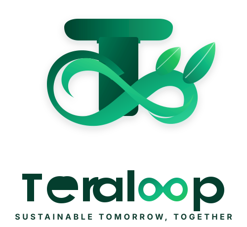

# 🌿 Teraloop — Sustainable Tomorrow, Together

> Entity Onboarding & Registration Portal for Sustainability Programs



---

## 🚀 Features
- **Live Interactive Onboarding Form** with real-time validation and progress tracking.
- **Dynamic User ID Suggestion** based on organisation name & city.
- **Secure Temporary Password Generation** with single-click clipboard copying.
- **Brand System**: Customized emerald-and-lime sustainability visual identity.

---

## 🛠️ Getting Started

### 1. Clone the repository
```bash
git clone https://github.com/1531AdityaRaj/Teraloop.git
cd Teraloop
```

### 2. Install dependencies
```bash
npm install
```

### 3. Run development server
```bash
npm run dev
```
Open [http://localhost:5173](http://localhost:5173) in your browser.

---

## 📦 Build for Production
```bash
npm run build
```
The output will be in the `dist` directory.
